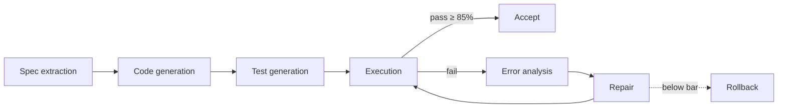

<h1 align="center">Adnan Waasi</h1>

  <b>Backend + applied AI.</b> I build systems that check their own output. 
  <i>If it doesn't run, it doesn't ship.</i>

  
  <a href="https://github.com/adnanwaasi">

---

### 🔭 Right now

- 🌐 [adnanwaasi.vercel.app](https://adnanwaasi.vercel.app)

---

### 🧭 What I care about

**Correctness over demos.** **Testable boundaries.** **Architecture you can still explain six months later.**

> Everything here has been run, and I know it works.
> If it doesn't work, it isn't here.

How that plays out in practice:

| Principle | What it means in my code |
| --- | --- |
| Verify, don't trust | Generated output gets executed and tested before anything accepts it |
| Idempotent by default | Content hashing and dedupe, so a retry never double-processes |
| Explicit state | Work moves through a state machine, not through loose flags |
| Safe concurrency | Workers claim jobs through the database, not through hope |
| Roll back | If a change doesn't meet the bar, the last good version stays |

---

### 🛠️ Selected work

| Project | What it does | Stack |
| --- | --- | --- |
| [**code synthesizer and validator**](https://github.com/adnanwaasi/fyproject) | Self-repairing code synthesis: spec extraction → generation → test generation → execution → error analysis → repair. Rolls back anything under an 85% acceptance bar. | Python · FastAPI · LangChain · Pydantic |
| [**f1 lap_time_simulation**](https://github.com/adnanwaasi/lap_time_simulation) | originally i wanted to make my quali simulations and check who has better chances at winning and what could be quali laps then later made it into race simulations | C++ · Python |
| [**faster one**](https://github.com/adnanwaasi/mini_laps) | a game built to improve your observability and reaction time  | C++  |

<b>fyproject pipeline at a glance</b>

---

### 🧰 Toolbox

**Languages**

  
  
  
  
  

**Backend & data**

  
  
  
  
  

**AI / LLM**

  
  
  
  
  
  
  

**ML**

  
  
  
  
  
  

**Infra**

  
  
  
  

**Frontend**

  

---

### 📊 Activity

  
  

---

<i>Shipped only after it runs.</i>

